# Agent Hub for Claude Code

**Run a team of AI agents like a company. You are the CEO.**

Agent Hub is one screen where all your Claude Code agents report to you. A lead agent turns
your brief into a plan. Builders build it. Reviewers, security and QA check every task before it
counts as done. Test agents use your app as your real customers would and report what breaks.
You answer a question with one click, from your desk or your phone, and never open an agent's chat.

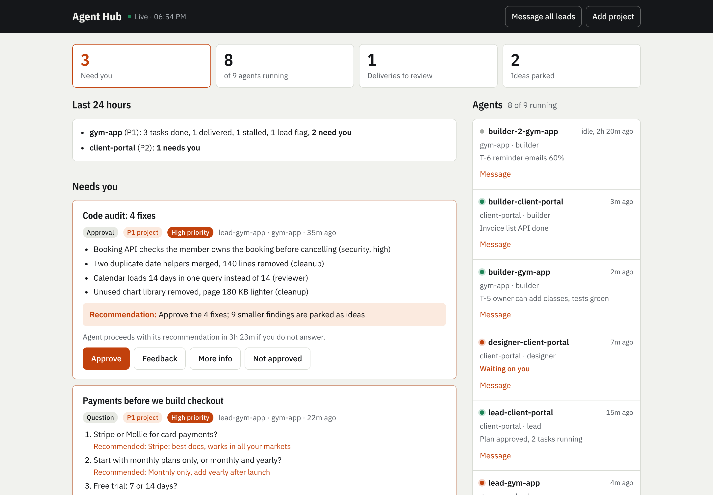

- **One inbox for every agent.** Questions, approvals and finished work from all projects arrive
  as short cards, each with the agent's recommendation. Approve, give feedback, ask for more or say no.
- **A lead agent that manages the others.** It plans, splits the work, checks every agent about
  every 30 minutes and keeps them on plan. New ideas wait in a backlog instead of creeping into the build.
- **Nothing is done until it is checked.** Code review on every task, security on anything with
  logins, money or personal data, QA on anything a user sees.
- **Your customers test the app before they see it.** Describe Maria, 68, on a phone with poor
  eyesight. An agent uses the app at 200% zoom as Maria and sends you the screenshots of where she got stuck.
- **One click starts the whole team.** Claude builds the dashboard for you as a private page on
  claude.ai. **Start in the cloud** launches every agent as a Claude Code session. Nothing to install.

[Set it up in 3 steps](#set-it-up-in-3-steps) · [Read the manual](docs/MANUAL.md) · [Team guide](docs/TEAMS.md)

**Try it first:** the [demo hub](https://claude.ai/artifact/9mGDgzk2MaJXm4EzJMg74A) runs with sample
projects and agents. Approve cards, start agents, set a budget: nothing is saved.

---

## An example day

You write a brief: "A class booking app for my gym. Members book and cancel classes on their
phone, the owner adds classes. Payments in phase 2. Deadline: 4 weeks."

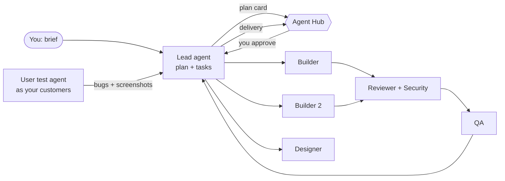

- **09:00** The lead posts the plan: 9 tasks, what is in, what is out. You tap **Approve**.
- **09:05** Two builders start on separate parts. The designer posts the booking screen for approval,
  with a screenshot and its color table.
- **11:30** A builder needs a decision on payments. Three questions arrive as one card, each with a
  recommendation. You reply `1 yes, 2 monthly and yearly, 3 14 days` from your phone in line at the coffee shop.
- **13:00** The reviewer sends a task back: a member could cancel someone else's booking by changing
  an id. The builder fixes it, security passes it, QA tests it in a browser. Only then is it done.
- **15:00** The user test agent books a class as Maria. The time picker is too small to tap at
  200% zoom. The lead turns it into a fix task.
- **17:00** A delivery card arrives: the booking flow, live on a test link, with test results.

You spent about ten minutes on it.

---

## Every decision is one card

Agents never ask in a chat you have to find. Every question, approval and delivery is a card in
**Needs you**, highest priority first, written like a note to a busy CEO: five bullets at most, a
recommendation, and an **Approve** button.

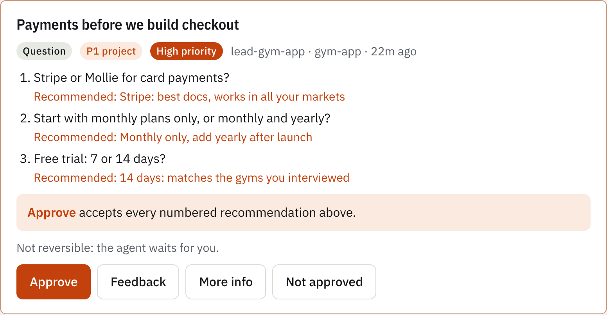

Answer per number in one line. The agent gets your answer on its next step.

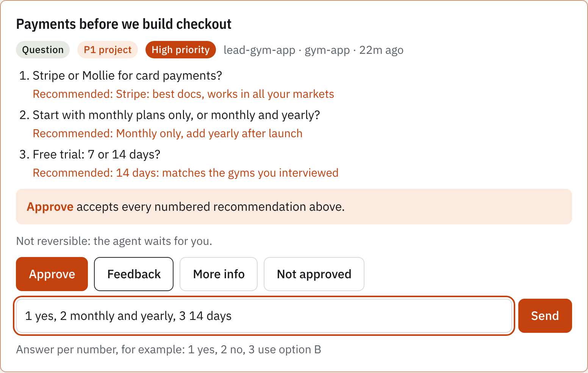

Design decisions arrive with the screenshot and a color table, so you approve what you see,
not a description of it.

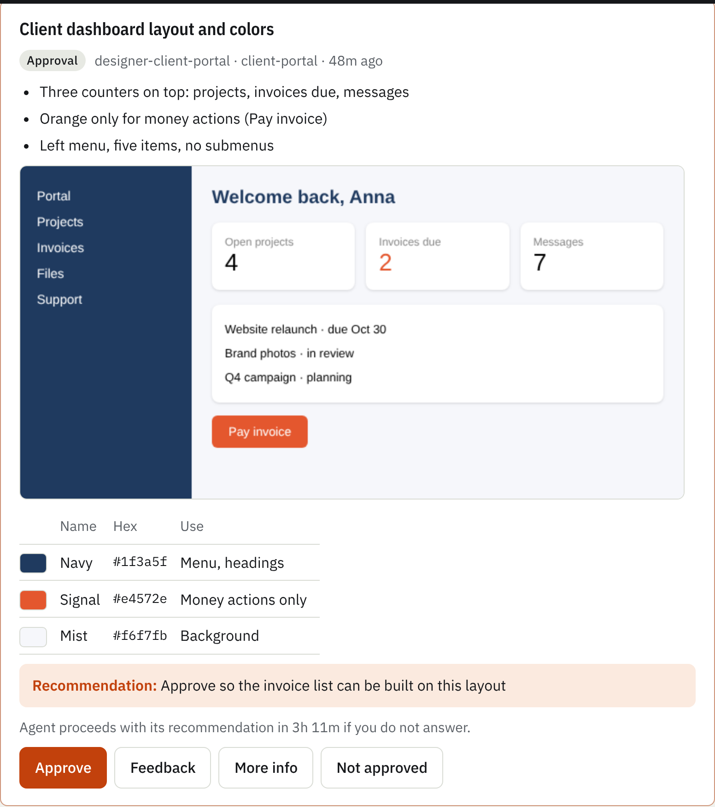

| Button | What happens |
|---|---|
| **Approve** | The agent does what it recommended. On a numbered card, every recommendation is accepted. |
| **Feedback** | One line of text, also per number. |
| **More info** | The agent comes back with the missing facts. |
| **Not approved** | The agent drops it and carries on with other work. |

**Your phone buzzes when it matters.** Agents send a push alert and an email for high-priority cards and
anything that cannot be undone, or for every card if you prefer. Set it next to **Needs you**.

**You are never the bottleneck.** A reversible decision shows a 4-hour clock. If you have not
answered by then, the agent goes with its own recommendation and tells you. Anything you cannot
undo (deleting data, payments, publishing, production) waits for you, no exceptions.

---

## A real team, with real roles

Each agent has one job and a written role card ([ROLES.md](ROLES.md)). Pick a team when you add a
project, or type your own list.

| Team | Agents | Use it for |
|---|---|---|
| **Solo** | lead, builder | Small fixes, landing pages, scripts |
| **Standard** | lead, builder, reviewer, security | Most apps |
| **Product** | lead, designer, 2 builders, reviewer, qa | Apps with many screens |
| **Secure** | lead, architect, 2 builders, reviewer, security, qa | Payments, personal data, production |
| **Review** | lead, builder, reviewer, security, cleanup, usertest | An existing app you want checked and cleaned up |

| Role | What it does for you |
|---|---|
| **Lead** | Turns your brief into a plan, assigns tasks, checks every agent about every 30 minutes, merges the work, flags you only for decisions |
| **Architect** | Picks the stack and data model before anyone builds, so two builders never solve the same problem two ways |
| **Designer** | Screens, states, colors and accessibility; posts each screen for your approval before it is built |
| **Builder** | Builds one task at a time, test first, on its own branch; runs tests, build and lint before handing over |
| **Reviewer** | Reads the real code and runs the tests itself; the builder's summary is a claim, not evidence |
| **Security** | A 10-point checklist: injection, logins, access control, secrets, uploads, payments, dependencies |
| **QA** | Tests every screen from the user's side in a real browser, error cases included, with screenshots |
| **Usertest** | Uses the app as each of your customer profiles and reports bugs, blockers and confusing spots |
| **Cleanup** | Finds dead code, duplicates and unused packages, and proves every finding before suggesting a delete |
| **Docs** | Keeps the README and setup steps true by running every command it documents |

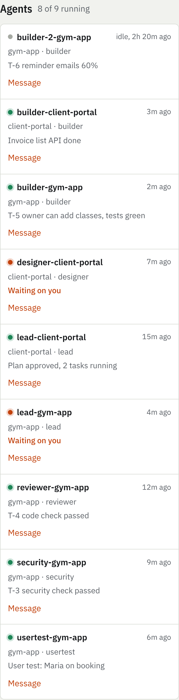

### Nothing is done until it is checked

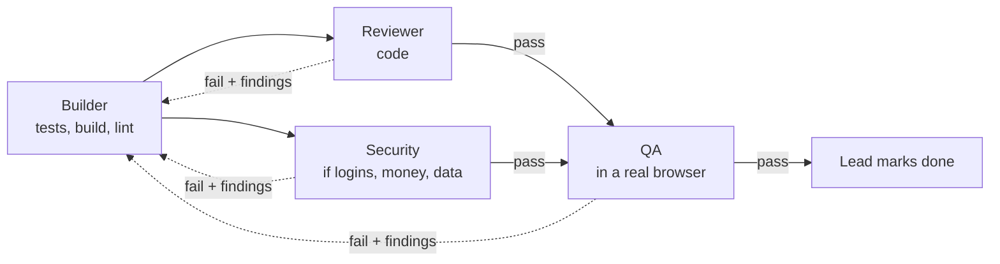

The builder cannot mark its own work done, and no agent can check its own work. A failed check
goes back to the same builder with the file, the line and what goes wrong. After 5 rounds on one
task the lead asks you. Before delivery, security sweeps the whole codebase once.

---

## Your customers test the app before launch

Most apps are tested by the people who built them. Agent Hub tests yours as the people who will
use it.

On a project card, open **Customer profiles** and describe who your customers are: name, age, IT
skill, device, goals and needs. Then click **Run user test** or **Test with all profiles**.

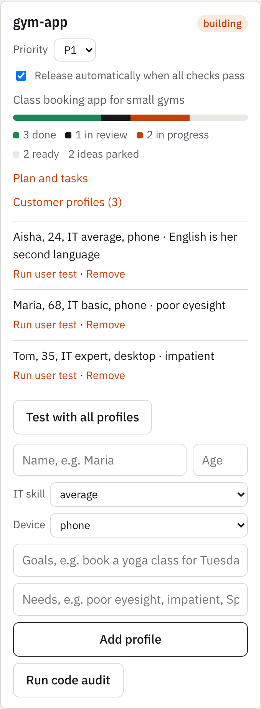

The test agent opens the app in a real browser and turns each profile into concrete test settings:

| If the profile says | The agent tests like this |
|---|---|
| IT skill none or basic | Reads every screen before acting, does not recognize icons without a label, never uses shortcuts, gives up after 2 failed tries and records where |
| IT skill advanced or expert | Moves fast: shortcuts, the back button, refresh halfway through, two tabs, odd input |
| Age 65+ or poor eyesight | 200% browser zoom, checks contrast, text size and tap targets of at least 44px |
| Phone | 390 by 844 screen, touch, slow connection |
| Tablet or desktop | 820 by 1180 or 1440 by 900 |
| Impatient | Leaves any step that takes over 5 seconds or 3 screens |
| Another language | Notes every word that is jargon or unclear |

Every finding gets a label: **bug** (becomes a fix task), **blocker** (Maria cannot finish; high
priority), **confusing** (it works, but she got lost) or **idea** (goes to the backlog, never built
without you). You get one short card with screenshots, and a full report lands in the repo.

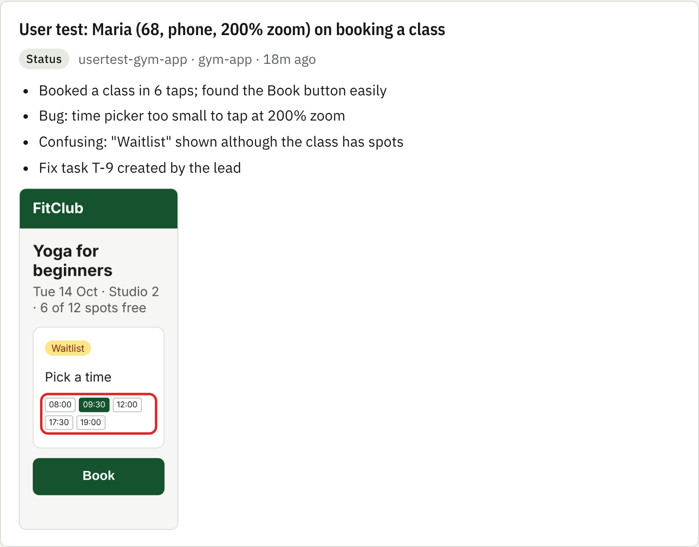

After the fix, the agent runs the same profile again and confirms it.

---

## A code audit by three reviewers, in one card

Click **Run code audit** on any project, new or years old. Three agents go through the whole
codebase separately:

- **Security** looks for holes: injection, missing access checks, secrets, unsafe uploads.
- **Cleanup** looks for code that should not be there: dead code, duplicates, unused packages.
- **Reviewer** looks for bugs, slow queries and code that hides bugs.

The lead checks every finding against the real code, drops duplicates and sends you one card.
Nothing changes until you approve, except critical security holes, which are fixed at once.

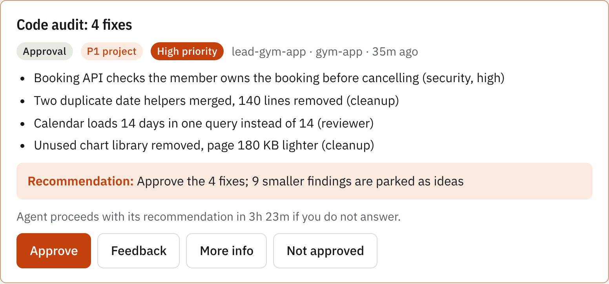

---

## Built for more than one project

- **Last 24 hours** at the top: one line per project, most important first. Worked out from the
  hub's own data, so it costs nothing.

  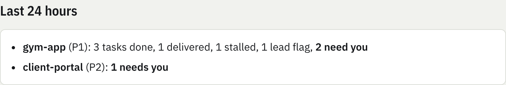

- **Cost per project, with a budget.** Every project card shows what its agents cost so far. Set
  a budget: at 80% the lead warns you, at 100% the agents finish their step and stop until you
  raise it.
- **Priorities.** Mark projects P1, P2 or P3. Cards from P1 always come first.
- **Message all leads.** One instruction to every project at once, for example "Pause all deploys
  until Monday". Each lead passes it on to its own agents.

  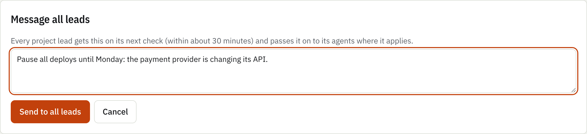

- **Automatic releases, with exceptions.** When every task is done and every check passed, the lead
  releases on its own. The first release to real users, database changes that delete or reshape
  data, and anything with payments always ask you first.
- **Lessons carried forward.** After each project the lead saves up to 5 one-line lessons and
  reads them when it plans the next one.
- **An ideas backlog.** Good ideas from agents and test users are parked, not built. You decide later.
- **Finished work with proof.** Deliveries come with links, test results and screenshots.

  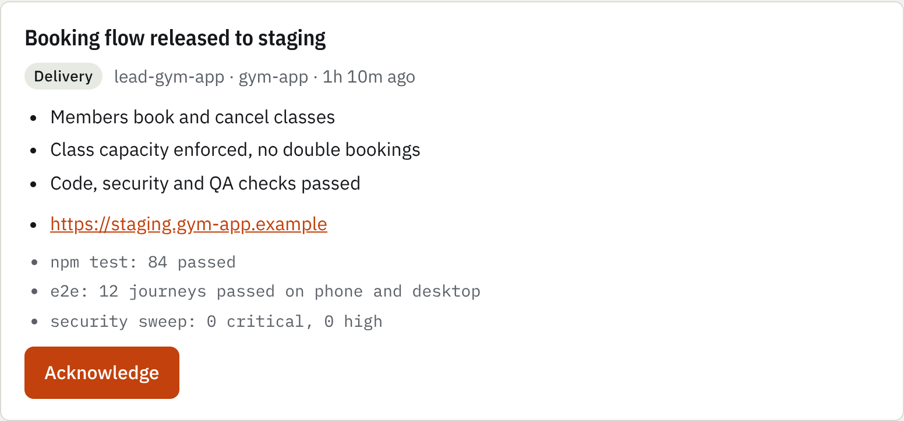

---

## On your phone, in light and dark

The page works in the Claude app on your phone, follows your light or dark setting and stays
readable at 200% zoom.

<p>
  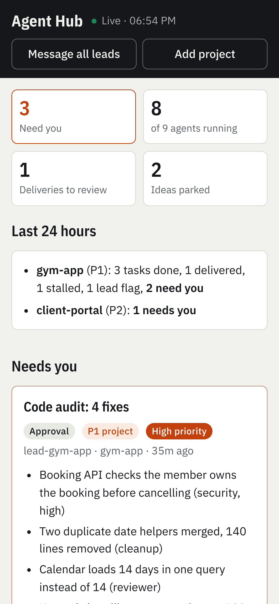
  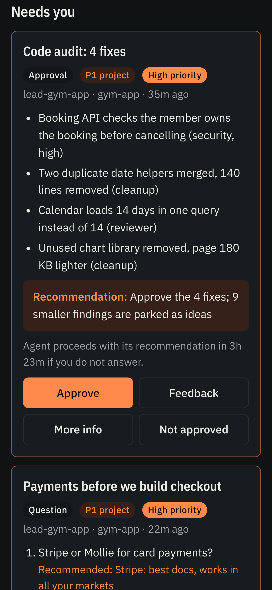
</p>

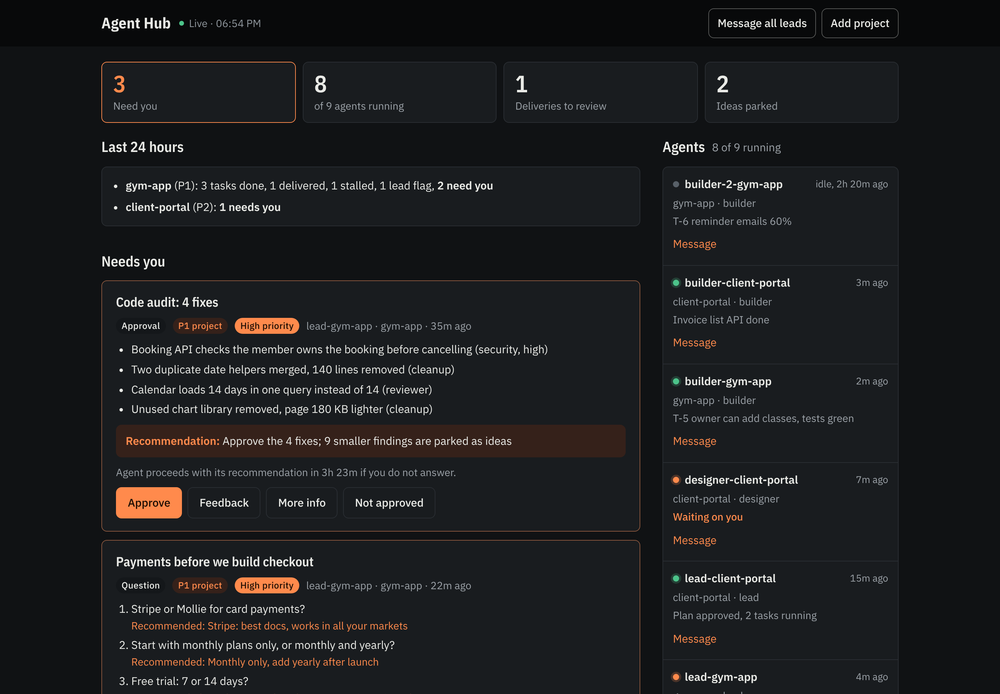

---

## It tested itself

Before we shipped this version, we pointed Agent Hub at its own code. Real agents, real findings:

- **Security, reviewer and cleanup agents** audited the codebase. Their high-severity findings came down to 5 fixes,
  among them old open cards dropping out of **Needs you** and saved filters hiding decisions. The lead checked them, merged duplicates and sent **2 approval cards**.
- **The fixes were verified by the same agents.** The re-test confirmed every high issue closed and
  found one more, which was then fixed too.
- **A user test agent tested as Maria, 68, on a phone at 200% zoom.** She found that the header
  buttons overlapped and the page scrolled sideways.

  <p>
    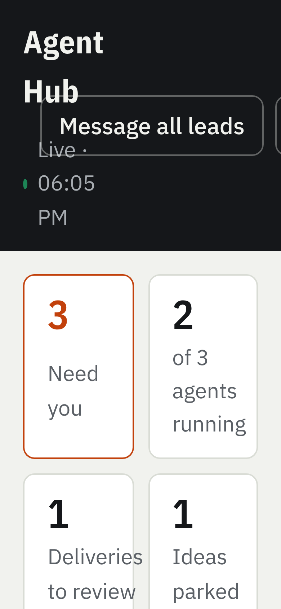
    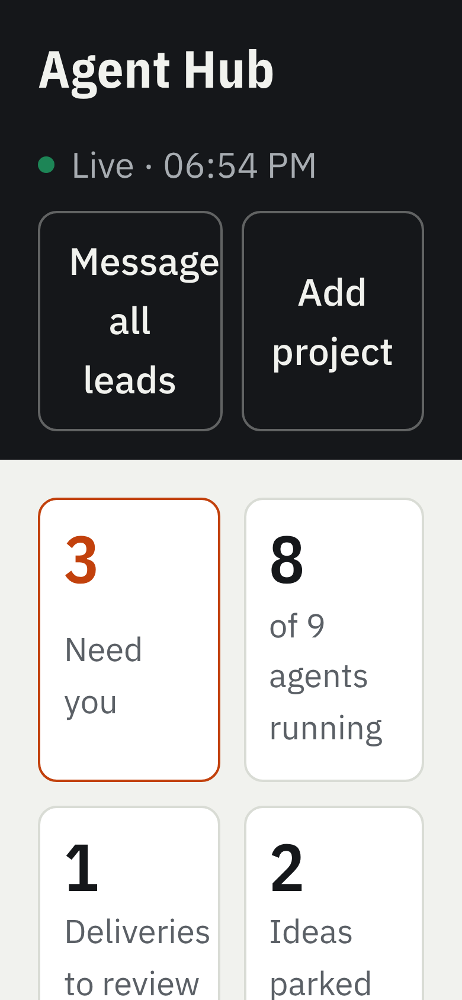
  </p>

- **The re-test caught a new bug the fix had caused** (a color table that wrapped one letter per
  line). It was fixed before release. That is the point of the checks: no fix is trusted until an
  agent other than the one who made it has tested it.

The full reports the agents wrote are on the
[selftest branch](https://github.com/giovannibrees/Claude-Dashboard/tree/selftest/docs): code
audits in `docs/audits/`, user tests with screenshots in `docs/user-tests/`.

---

## Set it up in 3 steps

**1. Let Claude build your hub.** Paste this into any Claude chat or Claude Code session:

```text
Set up the Agent Hub from https://github.com/giovannibrees/Claude-Dashboard for me:
1. Publish cloud/agent-hub.html as an artifact with the db and assets capabilities, and the mcp capability for the "Claude Code Remote" connector with the tools list_environments, create_session and get_session.
2. Replace HUB_URL_PLACEHOLDER in the page with the artifact's own URL and publish it again to the same URL.
3. Store the text of cloud/PROTOCOL.md in the artifact's database: collection "config", doc "protocol", field "text".
4. Store the text of ROLES.md the same way: collection "config", doc "roles", field "text".
5. Create a routine named "Agent Hub alert" with no schedule, a fresh session per run and push and email notifications on. Its prompt: relay the appended message as the final answer, plus a link to the hub, without using tools. Store its trigger id in the database: collection "config", doc "alert-relay", field "trigger_id".
Then give me the link.
```

You get a private link. Bookmark it, and add it to your phone's home screen.

**2. Add a project.** Click **Add project**, pick a team and paste your brief. You get one start
line per agent.

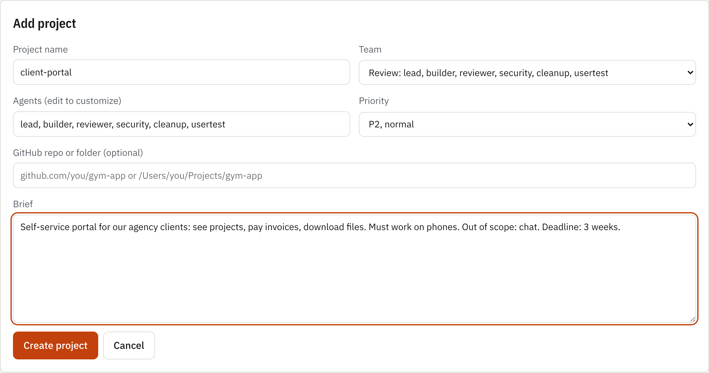

**3. Start the agents with one click.** Click **Start in the cloud**. The hub starts every agent
as a Claude Code session on claude.ai, in auto mode, on your GitHub repo, lead first. Each agent
gets an **Open session** link in the Agents list, and **Start again** brings back one that stopped.
Prefer your own machine? Open a Claude Code session per agent, switch it to auto mode and paste
its start line.

The lead posts the plan to **Needs you** within minutes. Approve it and the team starts building.
For the next project, click **Add project** again. One hub serves all of them.

---

## Questions

**What does it cost?**
Running Agent Hub for your own projects is free under the license below. The agents run on your own Claude plan.
To keep usage down: agents stop when their work is delivered instead of waiting, reviewers wake
only when there is something to review, and the [team guide](docs/TEAMS.md#keeping-cost-down)
shows which roles can run on a cheaper model.

**Do I need to install anything?**
No. The dashboard is a page on claude.ai and the agents are ordinary Claude Code sessions. Your
projects stay untouched: no files are added to them.

**Can agents do something I cannot undo?**
Not without you. Deleting data, payments, publishing and anything touching production always
wait for your approval. The 4-hour rule applies only to reversible decisions.

**Does it work with an existing project?**
Yes. Add it as a project with a brief that says where things stand, or start with the **Review**
team: a code audit and user tests before anyone builds anything new.

**Who can see my hub?**
Only you. The page is private on your claude.ai account. Use its Share menu to give a colleague access.

---

## Documentation

- [Manual](docs/MANUAL.md): setup, daily use, every feature, troubleshooting
- [Team guide](docs/TEAMS.md): which agents to pick, how work is split, the checks
- [Role cards](ROLES.md): what each agent does and never does
- [Agent rules](cloud/PROTOCOL.md): the rulebook every agent reads from the hub

## License

Source available, all rights reserved. This is not open source.

- You may run Agent Hub to manage your own projects, free of charge.
- Copying, sharing, reselling, using it for client work, offering it as a service or building a
  competing product needs a written license.

See [LICENSE](LICENSE). For a commercial license, contact [Giovanni Brees](https://github.com/giovannibrees).
