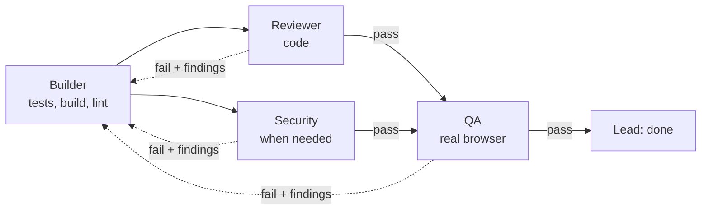
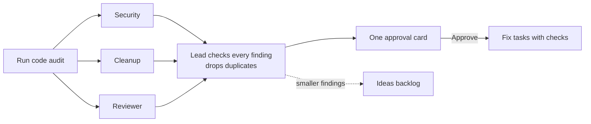
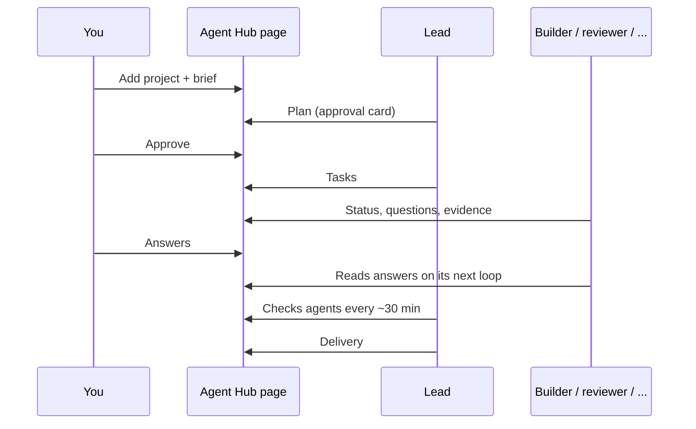

# Agent Hub manual

Agent Hub is one screen where all your Claude Code agents report to you. You set the goal, approve
the plan and make the decisions only you can make. A lead agent runs the team, specialists build
and check the work, and test agents use your app as your customers would. This manual explains
every part of it.


## Contents

1. [What you need](#1-what-you-need)
2. [Set up your hub](#2-set-up-your-hub)
3. [Start a project](#3-start-a-project)
4. [Use it in your other Claude Code projects](#4-use-it-in-your-other-claude-code-projects)
5. [Needs you: making decisions](#5-needs-you-making-decisions)
6. [Your team and the checks](#6-your-team-and-the-checks)
7. [Design, QA and user tests](#7-design-qa-and-user-tests)
8. [Code audit](#8-code-audit)
9. [Running several projects](#9-running-several-projects)
10. [How it works and the rules agents follow](#10-how-it-works-and-the-rules-agents-follow)
11. [Troubleshooting](#11-troubleshooting)

---

## 1. What you need

- A claude.ai account with Claude Code (claude.ai/code). The hub is a private page on claude.ai,
  so there is nothing to install.
- A GitHub repo per project, if you want the agents to start in the cloud with one click.
- The Claude app on your phone, if you want alerts and to answer on the go.

---

## 2. Set up your hub

You do not need to copy any files. Paste this into any Claude chat or Claude Code session that
can create artifacts:

```text
Set up the Agent Hub from https://github.com/giovannibrees/Claude-Dashboard for me:
1. Publish cloud/agent-hub.html as an artifact with the db and assets capabilities, and the mcp capability for the "Claude Code Remote" connector with the tools list_environments and create_session.
2. Replace HUB_URL_PLACEHOLDER in the page with the artifact's own URL and publish it again to the same URL.
3. Store the text of cloud/PROTOCOL.md in the artifact's database: collection "config", doc "protocol", field "text".
4. Store the text of ROLES.md the same way: collection "config", doc "roles", field "text".
5. Create a routine named "Agent Hub alert" with no schedule, a fresh session per run and push and email notifications on. Its prompt: relay the appended message as the final answer, plus a link to the hub, without using tools. Store its trigger id in the database: collection "config", doc "alert-relay", field "trigger_id".
Then give me the link.
```

Claude publishes a private page and gives you its link. Bookmark it and add it to your phone's
home screen. You do this once: the same page serves all your projects.

The page is private, so only you can open it. To give a colleague access, use the page's Share menu.

---

## 3. Start a project


1. Open your hub and click **Add project**.
2. Fill in:
   - **Project name**: short, for example `gym-app`.
   - **Team**: Solo, Standard, Product, Secure or Review. See [Pick a team](#pick-a-team).
   - **Priority**: P1, P2 or P3. Cards from P1 projects always come first.
   - **GitHub repo or folder** (optional): where the code lives.
   - **Brief**: what the app is, who it is for, the must-have features, what is out of scope, and the deadline.
3. Click **Create project**.
4. Click **Start in the cloud**. The hub starts every agent as a Claude Code session on claude.ai,
   in auto mode, on the project's GitHub repo. The lead starts first. If you have more than one
   cloud environment, pick one first; the hub remembers it. The first time, claude.ai asks you to
   allow the page to use Claude Code.

### Starting and restarting agents

- Each started agent shows **Open session** in the Agents list, so you can watch it work.
- An agent that stopped shows **Start again**. Use it when the lead flags that an agent is needed.
- A failed start says why on the agent's card, for example that Claude Code is not connected.
  When the message says the session may have started anyway, check claude.ai/code before you
  click again, so you do not run the same agent twice.

### Start agents yourself

Under **Or start them yourself** you get one start line per agent, each with a Copy button. Use
them to run agents on your own computer:

1. For each agent, open a new Claude Code session on the project's repo or folder:
   claude.ai/code, the Claude desktop app, or `claude` in a terminal.
2. Switch the session to **auto mode** (Shift+Tab in the terminal, or the mode menu in the app)
   so the agent can write to the hub without asking you each time.
3. Paste the start line. It begins with `/loop`, which keeps the agent working on its own.

### Write a brief the lead can plan from

The brief is the one thing only you can write. A good one takes five minutes:

```text
A class booking app for my gym, FitClub.
Who: members (many over 60, mostly on phones) and the owner.
Must have: members see the week's classes, book and cancel; owner adds and edits classes;
reminder email the day before.
Out of scope for now: payments, a native app, chat.
Deadline: 4 weeks. Hosting: Cloudflare.
```

The lead reads it, writes the plan with tasks and acceptance criteria, and posts the plan to
**Needs you**. Approve it, or use Feedback to change it. Nothing is built before you approve.

---

## 4. Use it in your other Claude Code projects

There is nothing to install per project. Your one hub page serves every project:

1. Click **Add project** for the new project.
2. Open a Claude Code session in that project and paste the start line the page gives you.

The start line tells the agent where the hub is and to read its rules from the hub itself, so the
project's own files stay untouched. Work you started earlier works the same way: add it as a
project with a brief that describes where things stand, or start with the **Review** team.

---

## 5. Needs you: making decisions

**Needs you** holds every question and approval from every agent. The count shows in the browser
tab. Cards are sorted by project priority (P1 first), then high-priority items, then the ones
waiting longest.

### What a card looks like

Agents write like they would to a busy CEO: a clear title, five bullets at most, and a
recommendation. Questions come batched, numbered, each with its own recommendation.


| Button | What happens |
|---|---|
| **Approve** | The agent does what it recommended. On a numbered card, every recommendation is accepted. |
| **Feedback** | Type a one-line answer. Answer per number: `1 yes, 2 no, 3 use option B`. |
| **More info** | The agent posts a follow-up with the missing facts. |
| **Not approved** | The agent drops it and continues other work. |


### Phone alerts

When a card needs you, the agent that posted it sends you a push notification and an email
through a Claude routine called **Agent Hub alert**. Choose how often next to the **Needs you**
heading:

| Setting | You get an alert for |
|---|---|
| **Important cards** (default) | High-priority cards and decisions that cannot be undone |
| **Every card** | Every question and approval |
| **Off** | Nothing; check the page yourself |

Status updates, ideas and deliveries never send an alert. The setup prompt creates the routine:
it has no schedule and only runs when an agent fires it, about a minute of Claude time per alert.
Its id is stored in the hub (`config/alert-relay`). Without it, agents skip the alert and the card
is in the hub either way.

### The 4-hour rule

Agents never sit idle waiting for you. While a question is open they keep working on everything
else. A reversible decision shows a clock: if you have not answered within 4 hours, the agent goes
with its own recommendation and posts a status saying so.

Some decisions never time out. Deleting data, payments, publishing anything public, production
data and scope changes always wait for your answer.

### When an agent stopped before reading your answer

Agents stop when their work is delivered, even with a question still open, so you do not pay for
agents that only wait. If an answer is not picked up within 30 minutes and its agent has stopped,
the lead takes it over: it acts on it, hands it to another agent, or tells you which agent to
restart. Answered cards in the feed say "Not picked up yet" until an agent reads them.

---

## 6. Your team and the checks

### Pick a team

| Team | Agents | Use it for |
|---|---|---|
| Solo | lead, builder | Small fixes, landing pages, internal scripts. The lead reviews. |
| Standard | lead, builder, reviewer, security | Most apps |
| Product | lead, designer, builder, builder-2, reviewer, qa | Apps with many screens |
| Secure | lead, architect, builder, builder-2, reviewer, security, qa | Payments, personal data, real users, production |
| Review | lead, builder, reviewer, security, cleanup, usertest | An existing app: code audit plus user tests |

You can also type your own list. The name sets the role: names starting with `lead`, `architect`,
`design`, `review`, `security`, `qa`, `usertest`, `cleanup` or `docs` get that role, everything
else is a builder. Start small and add a role when you miss it: bugs slipping through (add a
reviewer), anything with logins or money (add security), many screens (add a designer and QA).
Seven agents per project is the useful maximum.

### What each role does

| Role | Does | Never does |
|---|---|---|
| Lead | Plans from your brief, assigns tasks, checks every agent about every 30 minutes, merges work, escalates only decisions | Builds features, approves its own plan |
| Architect | Writes the stack, data model and module boundaries before building starts | Writes feature code |
| Designer | Screens, states, color table, accessibility; posts each screen for approval | Writes application logic |
| Builder | One task at a time, test first, own branch; runs tests, build and lint before review | Adds features or packages the task does not ask for |
| Reviewer | Reads the real diff and runs the tests itself; pass or fail with findings | Edits product code, passes untested work |
| Security | 10-point checklist on every sensitive task, plus a full sweep before delivery | Attacks live systems |
| QA | End-to-end tests of every user-facing task in a real browser, with screenshots | Weakens a test to make it pass |
| Usertest | Uses the app as your customer profiles | Fixes code, invents goals |
| Cleanup | Finds dead code, duplicates and unused packages, with proof | Restyles working code for taste |
| Docs | Keeps the README and setup true by running every command | Changes application code |

The full cards are in [ROLES.md](../ROLES.md).

### How the lead splits the work

- **One task, one goal.** A task delivers something a user can see or use, end to end.
- **Small enough for one session**, with acceptance criteria written as "Given ... when ... then ...".
- **No two builders on the same files at the same time.** Overlapping tasks run one after the other.
- **Design before build.** Screens are approved before their build task starts.

### The checks



| Check | Who | Required when |
|---|---|---|
| code | reviewer (the lead in a Solo team) | always |
| security | security | login, accounts, permissions, user input, uploads, payments, personal data, secrets, database queries, external APIs, new packages |
| qa | qa (the designer for pure visual work) | anything a user sees or clicks |

Every reviewer uses the same scale. Critical and high block the task, medium is fixed if cheap,
low never blocks. Each finding names the file, the line, what triggers it and what goes wrong.
After 5 failed rounds on one task, the lead asks you what to do.

---

## 7. Design, QA and user tests

Three agents look at your app from the outside: the designer decides how it should look, QA proves
it works, and the usertest agent finds out whether real people can use it.

### Design approvals

The designer writes `docs/DESIGN.md` (screens, layout, empty, loading and error states, colors, type
sizes, contrast and focus) and posts every screen to **Needs you** before it is built. The card
shows the screenshot and a color table with name, hex and where each color is used.


Approve it, or reply with Feedback such as "darker navy, signal color only on the pay button". The
builder starts the screen only after your approval, so you never pay for building the wrong design.

### QA

When a user-facing task passes code review, QA writes and runs browser tests for every acceptance
criterion, including the error cases: wrong input, not logged in, page not found. It attaches a
screenshot of each tested screen. A flaky test is fixed or reported, never skipped. The designer
also compares built screens to the approved design and sends differences back.

### Customer profiles

On a project card, open **Customer profiles** and add the people who will use your app.


| Field | Example |
|---|---|
| Name | Maria |
| Age | 68 |
| IT skill | none, basic, average, advanced or expert |
| Device | phone, tablet or desktop |
| Goals | Book a yoga class for Tuesday, cancel it again |
| Needs | Poor eyesight, impatient, Spanish speaker |

Three profiles cover most apps: a beginner on a phone, an expert in a hurry on a desktop, and
someone who reads the app in a second language.

### Running a user test

Click **Run user test** next to a profile, or **Test with all profiles**. The job goes to the
project's usertest agent, or to the lead if the team has none. The agent opens the app in a real
browser and turns the profile into test settings:

| If the profile says | The agent tests like this |
|---|---|
| IT skill none or basic | Reads every screen fully, does not recognize icons without a label, never uses shortcuts or the back button on purpose, gives up after 2 failed tries and records where |
| IT skill average | Normal use, tries the obvious button first |
| IT skill advanced or expert | Fast: shortcuts, back button, refresh halfway through, two tabs, odd input |
| Age 65+ or poor eyesight | 200% browser zoom, checks contrast, text size and tap targets of at least 44px |
| Phone | 390 by 844 screen, touch, slow connection |
| Tablet / desktop | 820 by 1180 / 1440 by 900 |
| Impatient | Leaves any step that takes over 5 seconds or 3 screens |
| Another language | Notes every word that is jargon or unclear |

It follows the profile's goals plus the app's main journeys and thinks aloud: at each step it
writes down what the person expects and what happens.

### What you get back

A short card in your feed, five bullets at most, with screenshots:


And a full report in the repo, `docs/user-tests/<date>-<profile>.md`. An example:

```markdown
# User test: Maria (68, basic IT skill, phone, poor eyesight) on booking a class

Settings: 390x844 phone, 200% zoom, slow connection.

| Step | Maria expects | What happened |
|---|---|---|
| Open the app | Today's classes | Week view; Tuesday found after scrolling |
| Tap "Yoga for beginners" | Book button | Book button large and clear |
| Pick a time | Tap 09:30 | Missed twice, buttons are 20px high; got it on the 3rd try |
| See status | "Spots free" | Yellow "Waitlist" badge although 6 spots are free |

Findings
- bug: time buttons 20px high at 200% zoom, need at least 44px (screenshot 2)
- confusing: "Waitlist" badge shown on classes with free spots (screenshot 3)
- idea: "Add to calendar" after booking
```

| Label | Meaning | What happens next |
|---|---|---|
| bug | Broken or wrong | The lead creates a fix task |
| blocker | The person cannot finish the goal | Fix task with high priority |
| confusing | It works, but the person got lost | Fix task or idea, the lead decides |
| idea | An improvement | Ideas backlog, never built without you |

After the fix, the agent runs the same profile again and confirms the problem is gone. That re-test
matters: when Agent Hub tested itself, the re-test found a new bug that the first fix had caused.

<p>
  
  
</p>

The agent never uses real personal data or real payments, and never changes code.

---

## 8. Code audit

**Run code audit** on a project card asks for a review of the whole codebase by three reviewers who
work separately:

| Reviewer | Looks for |
|---|---|
| Security | Injection, missing access checks, secrets in code or history, unsafe uploads, risky packages |
| Cleanup | Dead code, duplicated logic, unused packages, leftover debug output, abstractions with one user |
| Code reviewer | Bugs, missing error handling, slow queries, work repeated in loops, oversized pages |



You get one card with the fixes worth making. Smaller findings are parked as ideas.


Nothing changes until you approve. The exception is a critical security hole, which is fixed at
once and reported. A real secret found in the code arrives as a separate high-priority card,
because deleting it from the code does not make it safe again: the key has to be replaced.

---

## 9. Running several projects

### Last 24 hours

The top of the page shows one line per project, most important first: tasks done, deliveries,
work sent back by checks, stalled tasks, lead flags and how many items need you. It is worked out
from the hub's own data, so it costs nothing.


### Priorities

Set P1, P2 or P3 on each project card. Needs you shows P1 cards first. Leads of lower-priority
projects keep working; you just see their questions later.

### Message all leads

**Message all leads** sends one instruction to the lead of every project, for example "pause all
deploys until Monday". Each lead picks it up on its next check (within about 30 minutes) and
passes it on to its own agents where it applies.


### Releases

Each project card has **Release automatically when all checks pass** (on by default). When every
task is done, every check passed and the security sweep is clean, the lead releases and posts a
"Released" update. You always get an approval card first for:

- the first release to real users,
- database changes that delete or reshape data,
- anything touching payments.

Turn the switch off to approve every release yourself.

### Lessons

After each project the lead saves up to 5 one-line lessons, for example "Ask about the payment
provider before planning checkout". It reads them when it plans the next project.

### Deliveries, flags and ideas

- **Deliveries**: finished work with links and proof it was tested. **Acknowledge** files it away.

  

- **Lead agent flags**: problems the lead thinks you should see, such as a builder stalled for two hours.
- **Ideas backlog**: new ideas from agents and test users. **Keep for later** or **Drop**. Nothing
  here is built until you start a project for it.

### The rest of the page

- **Agents**: a green dot means active in the last 30 minutes, gray means idle. Each shows its
  project, role, current task and "Waiting on you". Click a name to see only its items.
  **Message** sends one agent an instruction.

  

- **Projects**: phase, progress, plan scope, never-list, every task with its owner and status, and
  the customer profiles.
- **Feed**: everything else, newest first, including your past answers. Filter by agent, project and type.
- **Delete old items**: a link at the bottom when closed items are older than 30 days.

### On your phone

The page works in the Claude app and any phone browser, in light and dark, and stays readable at
200% zoom.

<p>
  
  
</p>

---

## 10. How it works and the rules agents follow



Behind the page is a small database that belongs to the artifact. Agents write their items to it
and read your answers from it with Claude Code's artifact tools. The rules and role cards are stored
in the same database, so every agent always reads the current version and your projects stay untouched.

The full rules are in [cloud/PROTOCOL.md](../cloud/PROTOCOL.md). In short:

- The hub is the only channel. Agents do not ask you in their own chat.
- Report like to a CEO: bullets and key facts only, five per item at most.
- Batch questions into one card with numbered points, each with a recommendation. Ask only when
  blocked, and keep working on everything else meanwhile.
- Screenshots for anything visual, color tables for anything about colors.
- Only planned tasks. New ideas go to the ideas backlog.
- A status at least every 2 hours. Deliver with proof, then stop. No invented work.
- The 4-hour rule applies only to reversible decisions.

### Keeping cost down

- Agents stop when their work is delivered instead of looping while they wait.
- Reviewers wake only when something is in review, and stop when the project is delivered.
- Put the lead and architect on the strongest model, builders and checkers on a mid-tier model,
  docs on the cheapest (`/model` when you start the session).
- Security runs on the tasks that need it plus one final sweep, not on every change.

---

## 11. Troubleshooting

| Problem | Fix |
|---|---|
| An agent keeps asking permission to write to the hub | Switch its session to auto mode, or approve once and allow ArtifactData for the session. |
| An agent shows Idle | It has not checked in for 30 minutes. Click **Start again** on its card, or open its session and paste the start line again. Loops end after 7 days. |
| Answers do not save | The page shows "Not saved" on the card and an **Allow saving** banner. Click it and allow the page's database, then answer again. |
| No **Start in the cloud** button | The page was published without the Claude Code connector, or you turned it off in the page's Permissions menu. Paste the start lines instead. |
| Your answer did not reach the agent | Agents read answers on their next loop check, usually within minutes. If the agent stopped, the lead takes the answer over within 30 minutes. |
| An agent asked you in its own chat | Tell it: "Use the hub for questions." The protocol says the hub is the only channel. |
| A UI card has no screenshot | The card shows a warning. Click **More info** and ask for the screenshot. |
| The page says it needs its database | Open the link on claude.ai while signed in. |
| "The hub database is full" | Use the delete link at the bottom of the page. The hub holds 25,000 records. |
| A colleague cannot open the link | Share it from the page's Share menu. |
